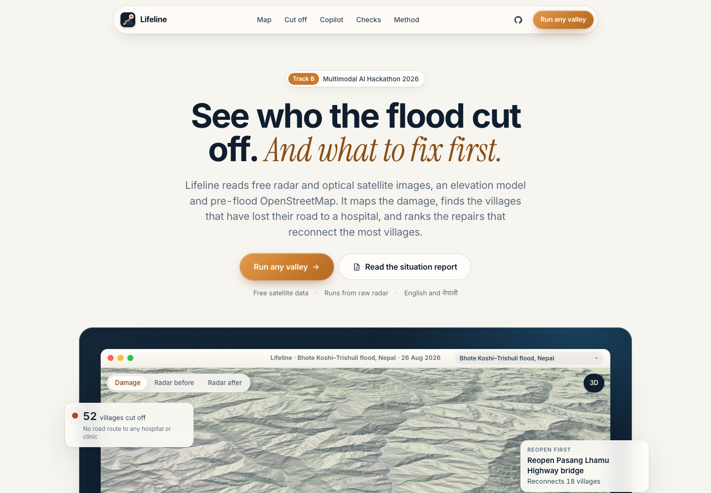

# Lifeline

**Who can still reach help.** Lifeline maps flood and debris damage from free satellite data, finds the villages that have lost their road to a hospital or clinic, ranks the repairs that reconnect the most of them, and writes the situation report in English and Nepali.

Track B, Multimodal AI Hackathon 2026 (IIT Mandi): *Mapping Flood Damage from Space*.

**Live:** dashboard https://lifeline-flood.vercel.app · engine https://kinnuworks--lifeline-web.us-east.modal.run (draw any box and date in "Run any valley"; a 10 x 10 km box takes under a minute)



## The case study, in numbers

The 26 August 2026 glacier-collapse flood on the Bhote Koshi–Trishuli corridor, Rasuwa, Nuwakot and Dhading, Nepal. One run over a 51 x 58 km area, from raw data:

| | |
|---|---|
| Radar passes compared | 15 (Sentinel-1D, 3 orbit tracks: the last pass before, the first after, 3 earlier passes each) |
| Ground mapped as flooded or buried by debris | 16.4 km²: 2.3 km² new open water, 14.1 km² debris and scour (1.4 km² of it added from Sentinel-2) |
| Ground the radar could not see (steep layover and shadow), marked as such | 108.9 km² |
| Buildings checked | 188,933: 2,974 likely destroyed, 631 possibly damaged |
| Roads checked | 7,412 km: 99.6 km lie under mapped debris or water |
| Bridges checked | 353: 59 likely destroyed, 12 possibly damaged |
| Settlements with a road to a hospital or clinic before the flood | 290 of 397 |
| Settlements now cut off from any hospital or clinic | 52 (48 of them with 90%+ probability); 1 more can still walk to care within an hour |
| The repair that reconnects the most | The 3 closed stretches of the Pasang Lhamu Highway around one bridge near Syapru Besi: 18 settlements |

### Checked against the official maps

Copernicus EMS activation EMSR927 graded the damage from very-high-resolution optical images. Lifeline never reads those maps; a separate checker compares them with the output after the run, and a test fails the build if pipeline code refers to them. The settings we searched were chosen on one official area only (3, Bidur) and frozen; areas 1, 2 and 5 are held out. Every place the official maps touched a design choice is listed below. Figures below use the first grading maps.

| Official map area | Role | Flood extent F1 | Precision | Recall | Damaged buildings we flagged | Damaged roads, agreement | Damaged bridges we flagged |
|---|---|---|---|---|---|---|---|
| 1 Syapru Besi | held out | 0.55 | 0.99 | 0.38 | 86% | 0.81 | 5 of 5 |
| 2 Timure | held out | 0.35 | 0.98 | 0.21 | 65% | 0.71 | 0 of 1 |
| 3 Bidur | development | 0.83 | 0.85 | 0.81 | 98% | 0.73 | 13 of 18 |
| 5 Phosretar | held out | 0.74 | 0.86 | 0.66 | 62% | 0.66 | 13 of 22 |
| All four | | **0.75** | **0.86** | **0.66** | **88%** | **0.71** (recall 0.89) | **31 of 46** |

**Held-out areas only (1, 2 and 5):** flood extent F1 0.66 (precision 0.88, recall 0.53), damaged buildings found 70% (601 of 857), damaged bridges found 18 of 28. Area 3 is the development area and carries most of the pooled pixels and buildings, so these held-out figures are the fairer estimate for a new valley.

Areas 4 and 6 were cancelled by EMS for cloud. Full table with 95% intervals: [`runs/trishuli-2026/validation/emsr927.md`](runs/trishuli-2026/validation/emsr927.md) (the later grading maps: [`emsr927_latest.md`](runs/trishuli-2026/validation/emsr927_latest.md)).

**Where we are weak.** In the narrow upper gorge (areas 1 and 2) we find a fifth to a third of the official flood extent, though what we flag there is almost always right (precision 0.98 to 0.99). The radar does see most of that ground; the debris there barely changed its radar brightness (median change 0.0 dB on the missed pixels). Sentinel-2 vegetation loss recovers part of it, which is why it is fused in.

**How the settings were chosen.** Radar settings: [`scripts/validate_fusion_dev.py`](scripts/validate_fusion_dev.py), record in [`validation/fusion_dev.json`](runs/trishuli-2026/validation/fusion_dev.json). Sentinel-2 fusion: [`scripts/validate_optical_dev.py`](scripts/validate_optical_dev.py), record in [`validation/optical_fusion_dev.json`](runs/trishuli-2026/validation/optical_fusion_dev.json). Both pick the best F1 on area 3 alone. The radar selection also required no more than 3 km² flagged on the no-flood date below, so that date is not an independent test of the radar settings; the two other floods are.

### Everything the official maps or the no-flood date influenced

So nothing is hidden, this is the full list:

1. **Radar settings** (orbit combination, seed size, growth distance): best F1 on area 3, with no more than 3 km² allowed on the no-flood date. Held-out areas were scored for every candidate and recorded, but not used to choose ([`fusion_dev.json`](runs/trishuli-2026/validation/fusion_dev.json)).
2. **Sentinel-2 fusion:** the idea came from looking at what we missed in held-out areas 1 and 2 (unchanged radar brightness on missed ground). Its three settings were then chosen on area 3 alone ([`optical_fusion_dev.json`](runs/trishuli-2026/validation/optical_fusion_dev.json)). The two selection scripts use slightly different reference masks (the older one includes EMS "not analysed" ground), so their radar-only baselines differ.
3. **Cut-off closure rule:** changed after we saw villages far from damage marked cut off; we had already scored that version against the official road grading.
4. **Copilot refusal detector:** extended after the red team, and the saved answers rescored.
5. **Fixed constants** not searched on any official area: HAND limits (60, 150, 30, 45 m), 0.99 false-alarm quantile, damage cut-offs 0.7 and 0.4, unobserved-road prior 0.15, 60-minute walking limit. They are physical or conventional choices set before the comparison and never tuned against it.

### Cut-off check

Treating the roads EMS graded destroyed as closed and running the same routing, Lifeline agrees on the status of 295 of 338 settlements (69 of the 98 whose route crosses a graded area). EMS grades roads only inside its six small areas, so its own cut-off count (7) is a lower bound. On the checker's network (338 settlements, 23 hubs) Lifeline marks 50 cut off; the headline 52 is from the full analysis (397 settlements, 25 health facilities). Most are behind the destroyed highway north of the graded areas. One design change came from looking at an earlier result: every road used to keep a small closure chance from its raw score, which summed over long hill routes and cut off villages far from any damage (148 in that version). Only roads the map flags or cannot see can close now.

### Does it raise false alarms, and does it work elsewhere?

The same code and settings, unchanged:

| Run | Ground flagged | Buildings likely destroyed | Run time (from its meta.json) |
|---|---|---|---|
| Trishuli, 26 Aug 2026 (case study) | 16.4 km² | 2,974 | 280 s (radar partly cached) |
| Same area, 25 Jul 2026, no flood (radar only) | 1.1 km² | 102 | 215 s |
| Melamchi, Nepal, 15 Jun 2021 (never tuned on; no clear Sentinel-2 in the window) | 1.4 km² | 150 | 105 s |
| Teesta glacial-lake flood, Sikkim, 4 Oct 2023 (never tuned on) | 8.6 km² | 490 | 538 s, of which 353 s Sentinel-2 |

The no-flood date runs on radar alone, because any Sentinel-2 image in the 40 days after 25 July would also show the 26 August flood. Melamchi and Teesta have no official grading to score against, so they show that the system runs anywhere, not how accurate it is there. All four are on the dashboard.

## What it does

Give it any area and any flood date.

1. **Where did the flood hit?** For every Sentinel-1 orbit track over the area it takes the first pass after the flood, the last before it and three earlier passes, all from the same track. A pass on the flood day itself is skipped, since it may be from before the water arrived. Each pixel is scored against its own normal range (a robust z-score, VV and VH). Layover and shadow are computed from the elevation model for each track and marked "not observed". The detection line comes from ground that cannot flood (more than 150 m above the nearest stream), so it controls the false-alarm rate without any published damage map. Strong change is grown along low valley ground, and isolated specks are dropped. New dark water seen by any track is open water; the rest is debris and scour. Where the sky was clear, Sentinel-2 vegetation loss or new water on valley ground (under 45 m above the stream) within 0.5 km of radar damage is added as "possibly damaged".
2. **What was damaged?** Every building, road and bridge in OpenStreetMap as it stood before the flood (ohsome API, snapshot at the earlier of the day before the flood and 27 July 2026, the newest date the API holds) gets the flood probability it is exposed to. Above 0.7 is "likely destroyed", 0.4 to 0.7 "possibly damaged". Features the radar could not see are "unobserved", never "clear". These are exposure labels from the map: a building next to mapped debris, not a building inspected on the ground.
3. **Who is cut off?** A routable network is built from the same pre-flood roads. Each road stretch the map flags closes with its own probability, unseen stretches with a prior of 0.15, and clear roads stay open; this is drawn 1,000 times, and each settlement gets the share of draws in which it cannot reach a hospital or clinic. Travel time before and after, walking time, a ranked repair list and the bridges that are single points of failure come with it.
4. **AI component: both options.**
   - **Flood segmentation model.** A U-Net with a ResNet-34 encoder (ImageNet start, allowed by the organisers), trained on Sen1Floods11 with India and Pakistan held out entirely. Sen1Floods11 test IoU 0.669 against 0.364 for a fixed threshold; Bolivia (held-out event) 0.661 against 0.617; the South Asian scenes it never saw 0.470 against 0.368. On Trishuli, masked to ground it can judge, it finds 60% of the new open water the radar change detection maps; on steep slopes it mistakes radar shadow for water, which is why it is a second opinion and not the map. Weights are in the repo (`src/lifeline/model/weights/lifeline_unet_s1.pt`, 49 MB). Details: [`docs/model/RESULTS.md`](docs/model/RESULTS.md), numbers in [`runs/model/metrics.json`](runs/model/metrics.json).
   - **Situation-report copilot.** Answers rescuers' questions and writes the one-page report in English and Nepali. Every number it may say lives in a facts ledger built from the maps; a guard checks every digit, Devanagari numeral and number word (English and Nepali) against the facts the copilot looked up, with their units, and rejects anything else. On a rejection it retries once, then falls back to fixed templates. Questions the maps cannot answer (deaths, reopening dates, how many helicopters) are refused. The guard checks numbers and units, not the meaning of the sentence around them.
   - **Red team.** 60 prompts in English, Nepali and romanised Nepali ([`tests/redteam_copilot.json`](tests/redteam_copilot.json)): injection, casualty bait, rounding, number words, predictions and ordinary questions. On the case-study run: 60 of 60 pass with templates alone and 60 of 60 with the model. One model answer ("That question is outside what I can answer") was a correct refusal that the refusal detector missed; the detector now recognises that phrasing and the saved answers were rescored without new calls (`scripts/redteam.py --rescore`). Rule-based refusals answer 39 of the 60 before the model is called. The guard catches 37 of 37 planted fabrications and raises no false alarm on 9 true statements filled from the run's own facts. Log: [`runs/trishuli-2026/copilot_redteam.json`](runs/trishuli-2026/copilot_redteam.json).
5. **Bonus: flood path.** Click any point upstream; Lifeline traces the path downhill on the elevation model, finds the valley floor along it and lists the settlements on it in order. From the Rasuwagadhi border crossing it traces 93 km and 27 settlements.

## Run it

```bash
uv sync
cp .env.example .env            # optional: ANTHROPIC_API_KEY for the copilot; everything else needs no key
uv run lifeline run --bbox 84.93 27.78 85.45 28.30 --date 2026-08-26 --id trishuli-2026
```

Any other area and date work the same way (boxes up to 1 square degree on the command line, about 60 x 60 km in the live engine). Cold runs took 2 to 6 minutes for the radar part on a laptop; Sentinel-2 can add several minutes, so the live engine skips it after 3 minutes and says so. Outputs land in `runs/<id>/` (layout in [`docs/CONTRACTS.md`](docs/CONTRACTS.md)): GeoTIFF maps, GeoJSON for buildings, roads, bridges and settlements, the facts ledger, and `sitrep_en.pdf` / `sitrep_ne.pdf`.

- **Dashboard:** `uv run python scripts/export_web.py trishuli-2026`, then `python3 -m http.server 5174 --directory web` and open http://localhost:5174.
- **Live engine** (what the dashboard's "Run any valley" panel calls): hosted on Modal (`modal deploy deploy/modal_app.py`, scales to zero when idle). Locally: `uv run uvicorn lifeline.api.server:app --port 8000`, then set `API_BASE` in `web/config.js`. A Dockerfile is included.
- **Check against the official maps:** `uv run python scripts/validate_emsr927.py fetch`, then `sh scripts/validate_run.sh trishuli-2026`.
- **Tests:** `uv run pytest -q`. One test fails the build if any pipeline code refers to a published damage map.

## Data rules

| Input | Source | Used for |
|---|---|---|
| Sentinel-1 RTC (VV, VH) | Copernicus, served by Microsoft Planetary Computer | flood and debris mapping |
| Sentinel-2 L2A | Copernicus, served by Microsoft Planetary Computer | vegetation loss and new water where the sky is clear |
| Copernicus DEM GLO-30 | Copernicus, served by Microsoft Planetary Computer | terrain, radar visibility, height above stream, flood path |
| OpenStreetMap | ohsome API, snapshot no later than 27 July 2026 | buildings, roads, bridges, settlements, health facilities |
| Sen1Floods11, Kuro Siwo | listed training data | the segmentation model |
| Copernicus EMS EMSR927 | official maps | checking only, in `src/lifeline/validate/` and nowhere else |

## Limits

- Sentinel-1 revisits each track every 12 days, so Lifeline maps damage after it happens. It cannot warn of a glacier collapse minutes ahead.
- In narrow gorges debris often barely changes the radar signal, and steep slopes are in layover or shadow. Recall in the upper Bhote Koshi is 0.21 to 0.38.
- Sentinel-2 helps only where the sky was clear; for this event the clear "after" images are 25 to 38 days after the flood.
- OpenStreetMap is incomplete in remote valleys: 107 settlements had no mapped road to care even before the flood, and unmapped buildings and bridges cannot be counted. Population is tagged for 3 of 397 settlements, so people counts are not reported as totals.
- Road closures are drawn independently per OSM way; one landslide that closes several ways counts as separate events. Facility capacity is not modelled, and OSM tags many health posts as hospitals.
- The bounding box of the case study reaches a few kilometres into Tibet; those places are routed only to facilities inside the box.
- The official maps grade selected areas from optical images; they are a yardstick, not ground truth.
- Village names mapped only in Devanagari are romanised automatically for English text and may differ from local spelling. Free-form Nepali copilot answers are checked for numbers, not for style.
- Educational prototype, not an operational tool. Numbers come from satellite analysis and have not been checked on the ground.

## Report and Q&A

- Six-page technical report: [`docs/REPORT.pdf`](docs/REPORT.pdf)
- Live-judging rehearsal sheet: [`docs/QA.md`](docs/QA.md)

## Credits and attribution

- Contains modified Copernicus Sentinel data 2021–2026.
- Produced using Copernicus WorldDEM-30 © DLR e.V. 2010–2014 and © Airbus Defence and Space GmbH 2014–2018 provided under COPERNICUS by the European Union and ESA; all rights reserved.
- © OpenStreetMap contributors.
- European Union, Copernicus Emergency Management Service data (EMSR927), used for checking only.
- Sen1Floods11: Bonafilia et al., *Sen1Floods11: a georeferenced dataset to train and test deep learning flood algorithms for Sentinel-1*, CVPR Workshops 2020.
- Kuro Siwo: Bountos et al., *Kuro Siwo: 33 billion m² under the water. A global multi-temporal satellite dataset for rapid flood mapping*, NeurIPS 2024 Datasets and Benchmarks.
- Fonts: Noto Sans and Noto Sans Devanagari (SIL Open Font License).

## AI tools used

The hackathon rules ask entrants to list these. Code, documentation and analysis scripts were written with the help of Claude Code. The copilot inside Lifeline calls the Anthropic API (Claude) to phrase answers; every number in those answers is checked against the facts ledger, and the copilot works without the API by falling back to templates.

Made by Dhiraj Kavuri. Code under the MIT licence; OpenStreetMap-derived data under ODbL.
